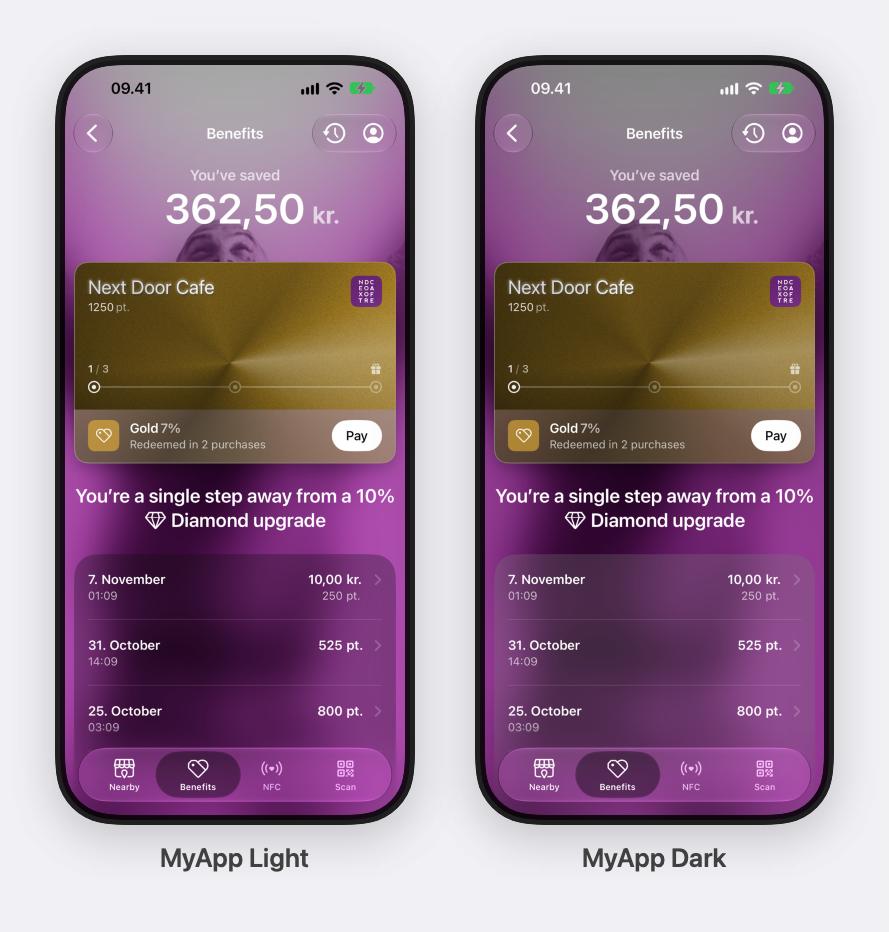
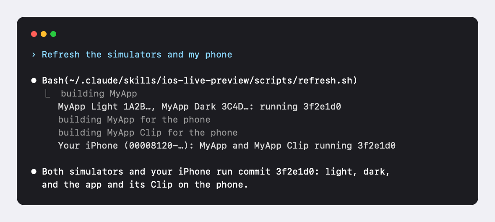

# iOS live preview

**See every change your coding agent makes, on a light simulator, a dark one and your own iPhone, without asking.**

A skill for [Claude Code](https://claude.com/claude-code). Install it, and in any iOS project your agent keeps three devices on the latest build of your working tree:

- **A simulator in light mode** and **one in dark mode**, side by side, so you check both appearances at a glance.
- **Your iPhone**, with the app and its App Clip if it has one, updated over Wi-Fi.

It does this at the start of every session and again after every change it builds. You look up from the conversation and the change is already running. No "can you run it so I can see?", and no Xcode build button.



## What you get

- **Always the latest build:** the agent rebuilds and reinstalls after every change, and tells you which commit the devices run.
- **Light and dark at once:** two named simulators, `<Name> Light` and `<Name> Dark`, created the first time and reused after that. The agent is told not to clutter your Mac with others.
- **Your phone too:** the app, then its App Clip (in that order, because installing an app removes its Clip), on the first iPhone paired with your Mac. If the phone can't be reached, you get a one-line note instead of a failed session, and the simulators are updated anyway.
- **Made-up data, if you want it:** launch arguments of your choice, for example to run against a demo or fixture mode so nothing reaches a server.
- **Shared with the team in one file:** a small `.ios-preview` in your project names the scheme. Commit it and everyone's agent sets up the same thing.



## Install

```bash
git clone https://github.com/kiminova/ios-live-preview ~/.claude/skills/ios-live-preview
```

That's it. Claude Code picks the skill up in your next session. To set it up for one project only, clone it into that project's `.claude/skills/` folder instead.

## First run

Open Claude Code in your iOS project and say something like *"Set up the live preview"*. The agent finds your app's scheme with `xcodebuild -list`, asks if it isn't sure, and writes `.ios-preview`:

```bash
SCHEME="MyApp"
NAME="MyApp"                  # the simulators: "MyApp Light" and "MyApp Dark"
CLIP_SCHEME="MyApp Clip"      # optional: put on the phone after the app
LAUNCH_ARGS=(-demo YES)       # optional: how the app is launched in the simulators
```

Optional too: `WORKSPACE` or `PROJECT` when the folder has several, `DEVICE_TYPE` for another simulator than the newest iPhone Pro, and `PHONE` (a udid) when more than one iPhone is paired.

From then on it runs by itself. You can also run it yourself:

```bash
~/.claude/skills/ios-live-preview/scripts/refresh.sh             # everything
~/.claude/skills/ios-live-preview/scripts/refresh.sh --no-phone  # the simulators only
~/.claude/skills/ios-live-preview/scripts/refresh.sh --no-build  # reinstall the last build
```

## Your iPhone

Once per phone:

1. Connect it with a cable, unlock it, and tap **Trust**.
2. Turn on **Developer Mode** (Settings › Privacy & Security › Developer Mode).
3. In Xcode, sign in with an Apple ID in your app's team (Settings › Accounts).

After that it updates over Wi-Fi, as long as the phone and the Mac are on the same network. The script wakes the connection first, because Xcode lists an idle phone as unavailable and would otherwise give up on it.

## Requirements

- macOS with Xcode and an iOS simulator runtime.
- An app scheme that builds for the simulator. For the phone, signing that works for development.
- [Claude Code](https://claude.com/claude-code). The script itself is plain zsh, so it works without it too.
